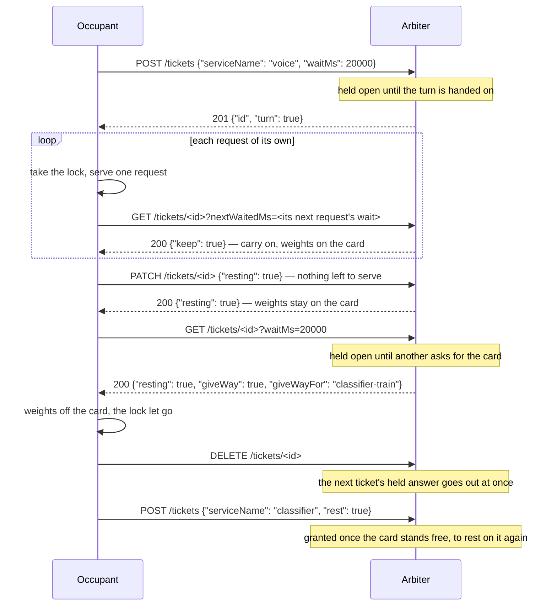

# The node arbiter

One process on every GPU node the system puts work on, keeping the rules of that node's card lock. It
is the package in `card/`, installed by the master's `install` verb (`docs/api.md`, 「The master's
command line」), and it knows none of the services that stand on it: each occupant names itself, the
node's occupants file says which may be on the card and in what order, the placement rules declare the
occupants that take the card outright and how each is seen, and the one service that borrows the card
over the network brings its lend settings.

## What it keeps

- **The node's card lock,** an exclusive `flock` on `~/.gpu.lock` in the node account's own home: the
  one lock every occupant on the node takes the card by (「The shared card lock」). The arbiter holds it
  itself only for an occupant that is not a process of the system's: a claimant, or the desktop.
- **The occupants:** who may be on the card, highest first, from the node's own file (「The occupants」).
- **The hold:** a queue every occupant waits in for its turn, ordered by the occupants, and the API it
  is asked through, which also serves as the arbiter side of an external job runner's resource
  negotiation protocol (「The hold」).
- **The units and the dump store:** what lies in the card's memory, one unloadable unit at a time, where
  each goes when it is unloaded — its owner's host memory, or the one file on the node's NVMe — and the
  rules that place them, as the slave of the master (`docs/placement.md`).
- **Its rules, each switched on by what the node has:**

  | Rule | On where | What it does |
  |---|---|---|
  | Claims | the rules declare a claimant | gives the card to a claimant before anyone, once the others have given way |
  | The desktop | the machine is a person's desktop | takes its turn for the desktop while it uses the card |
  | The keeper | always | ends a holder with no place among the occupants, and one below a claimant or the desktop past the grace |
  | The hold | always | keeps the queue and answers its API on the node's loopback |
  | Lending | lend settings stand on the node | lends the card to a borrowing engine's head over the inner network |

## The shared card lock

A node's card is shared by every service that runs a model there and by the arbiter, which holds the
card for the desktop and for claimants. They take turns by one lock, and a service that has the card
keeps its model on it until another asks for the card.

- **The lock:** an exclusive `flock` on `~/.gpu.lock` in the node's account, the same path for every
  service on that node, opened with create so whoever comes first makes it. The file's content means
  nothing. `CARD_LOCK` names it in the arbiter's own settings.
- **Taken before anything goes on the card:** a model's weights, a decision's or a generation's working
  memory. A service that has not got the lock puts nothing on the card.
- **Let go only once everything is off the card:** the weights dropped and the process's CUDA allocator
  cache emptied, so what the holder used is free for the next one. What a process may keep on the card
  without the lock is its CUDA context alone, a few hundred MiB that cannot be let go short of ending
  the process.
- **Held while its model rests there, and given up when asked:** a holder holds it through one use
  however long that use is, keeps it with its model on the card once the use ends, and lets go as soon
  as the arbiter says another occupant asks for the card (「Resting」).
- **A process that dies lets go of it,** since the kernel drops a flock with its last open file, so a
  crash never leaves the card locked.
- **Waiting is each service's own choice.** The lock says only who is on the card: every occupant but a
  claimant's task asks the arbiter for its turn first and waits in its queue, in the order the node's
  occupants give (「The hold」); how long it waits, and what it answers its own callers meanwhile, is the
  service's own to say in its own documents.
- **What a holder may assume:** no other service that follows the lock runs on the card while it holds
  the lock, so it may use the whole card less the other services' contexts and what the desktop keeps.
- **A claimant and the desktop take the lock first.** The arbiter takes it for as long as a claimant's
  claim stands (「Claimants」), or the desktop uses the card; a service still keeping the lock twenty seconds
  after a claim began is ended (「The keeper」).
- **What the arbiter says:** one journal line when it takes the card and why, and one when it gives it
  back, in the journal of `bmo-card.service`.

## The occupants

- **An occupant** is a claimant, the desktop, or a service, named by its own name. The arbiter sees the
  first two itself; a service names itself in its processes' environment as `BMO_CARD_SERVICE`, and
  nothing in the code keeps a list of the services. A process of a service that lends the card is named
  by the arbiter itself, as the lend service.
- **The order is the node's own file,** `~/.config/bmo-card/occupants`: its words, highest first, one
  line or several, `#` starting a remark. A word is an occupant's name, several names joined by `=`
  standing at one rank (`song=voice`), or `*`, which stands for every declared service the file does not
  name, never for a claimant.
- **Occupants of one rank never push each other out.** Neither stands above the other, so neither is
  ended for the other; their tickets stand in line by the arrival of the request each stands for, the
  other waiting with a `202` (「The hold」). The turn passes between them at a request boundary
  (「One queue of requests」), when its holder rests, or where the holder's own turn values have it give
  way (「One rank taking turns」).
- **A claimant the rules stand first comes first on every node, whatever the file says.** It waits only
  while the others give way, never behind any of them (「Claimants」); a file that names it elsewhere or
  not at all is read with it first, and one added to the rules moves first within a second, with no
  restart. A claimant the rules do not stand first has the place the file gives it, and none where the
  file names it nowhere.
- **An occupant the file leaves out has no place on the node:** the desktop rule holds nothing there,
  and a holder of the lock declaring such a service is ended at once. A holder declaring nothing — a
  person's work, a training run that declares no service — stands below every occupant named and is
  never ended for being unnamed.
- **The order is the master's to write,** derived from the services placed on the node and written
  whole by every placement that changes it (`docs/placement.md`, 「Occupants are derived」): the desktop
  on a person's desktop, the node's services by their declared priority, those of equal priority at one
  rank, and `*` on a node reserved for no service. It names no claimant, since those standing first come
  before it anyway. A node with no file at all is read as `*`.
- **Changed with no restart:** the arbiter looks at the file once a second and reads it again when it
  has changed. A file it cannot read leaves the order as it stood and says why in the journal.
- **Every change it takes up is kept:** one line in `~/.config/bmo-card/occupants.log` beside the file,
  the time, the order before and the order after, and the same line in the journal.
- **Shown by** `bmo-arbiter occupants --node <node>`: the order and the last changes the arbiter took
  up. It writes nothing; a different order is a placement's to make.

### One rank taking turns

- **An occupant may give way to one of its own rank by turn values of its own:** how long its turn is in
  use before it gives way to a waiter of its rank (`yieldAfterS`), and whether it can let go of the card
  in the middle of a request (`canPause`).
  - **Once its turn has been in use for its `yieldAfterS`** while a ticket of its rank waits, it gives
    way to that ticket: in the middle of a request where `canPause` is true, told `"giveWay": true` with
    `"giveWayFor"` as it is for an occupant above it (「Giving way」); at its next request boundary where it is
    false.
  - **The use is counted as `CARD_TURN_HOLD_S` counts it,** from the turn's grant or from the request
    that ended its rest (「One queue of requests」).
  - **An occupant whose `canPause` is true asks its tickets with `givesWayMs`,** which is what makes a
    turn hear `giveWay` at all.
  - **Its request boundary,** where `canPause` is false: for an occupant that asks `nextWaitedMs`, its
    answer's `"keep": false`, which `CARD_TURN_HOLD_S` already brings sooner where it is shorter; for the
    lent hold, which asks none, the head told `PASS` on its hold (「Lending」).
  - **The waiting order stays the queue's,** by rank and then by the arrival of the request each ticket
    stands for, so two of one rank take the card in turn, and neither waits on the other past the
    holder's `yieldAfterS`, the boundary or the letting go it then reaches, and its own units' coming
    back.
- **An occupant with no turn values is never made to give way to one of its rank.** Its turn passes only
  at the request boundaries `nextWaitedMs` hands on, or when it rests.
- **The values are each service's own,** declared in a `[turn]` table of its declaration
  (`docs/placement.md`, 「A service declares itself」). The arbiter keeps no list of them and names no
  service.
- **How they reach the arbiter:** the master writes them into the node's part of the rules,
  `~/.config/bmo-card/rules.json`, as a part of its own beside the four the rules file names:
  - `turns`, an object keyed by service name, each entry `yieldAfterS` in seconds and `canPause` true or
    false, one for every declared service whose declaration carries a `[turn]` table;
  - the same part on every node, as the claimants are, whichever services stand there;
  - read again within a second of a change, as the rest of the rules are, so a changed value is taken up
    with no restart; a service the part does not name, a node with no rules file and a rules file without
    the part all have no turn values.

## Claimants

- **A claimant is an occupant that takes the card outright** when it comes: nothing of the system's
  holds it back, and everything below it gives way. Which occupants are claimants, and everything about
  each, is the placement rules' `occupants` part (`docs/placement.md`, 「The rules」), pushed to every
  node; the arbiter's code names none of them.
  - **A typical claimant** is an external job runner whose agent starts jobs on the node in containers
    it names by a prefix: it stands first, is seen by its tickets, by its containers and by its processes
    on the card, and has every dump kept in host memory written out while it claims a node.
  - **A claimant added to the rules alone** is kept the same way on every node within a second of the
    rules reaching it: no code, no install, no restart.
- **A claim stands on the claimant's own word or its own work, never on what runs beside it.** It has
  three grounds: a ticket the claimant asks, a container it names, and a process of it on the card. What
  else runs on the node — under the claimant's unit or anywhere — claims nothing, since a unit runs
  whatever its account starts, a person's shell, a build or a browser among them, and none of that is
  the claimant's work on the card.
- **What the rules say of each claimant:**
  - `first` — it stands first on every node whatever the occupants file says (「The occupants」);
  - `seen_by.tickets` — a ticket it asks of the hold under its name is its claim (「The hold」); this is
    the ground a claimant is expected to use, and the default;
  - `seen_by.containers` — a running container whose name starts with this prefix, as the node's
    container runtimes list it, is its claim, and a process inside such a container is the claimant's on
    the card;
  - `seen_by.cgroup` — not set unless neither of the others can see the claimant: a process on the card
    whose cgroup lies in this unit's is the claimant's on the card, and nothing else in the unit claims.
    The unit is looked for as a system unit and as the node account's own user unit, or named outright
    by a cgroup's path;
  - `ram_free` — the host memory, in GiB, the node keeps available while it claims, or `all`, every dump
    kept in host memory written out (`docs/placement.md`, 「Host memory」).
- **The claim** begins when a ticket of the claimant is asked for, a container of it is listed, or a
  process of it is found on the card, and ends once the node has held none of them for ten seconds
  (`CARD_CLAIM_SETTLE_S`); the tickets are looked at ten times a second (`CARD_CLAIM_POLL_S`), the
  containers and the card every two seconds. A container running under a granted ticket is the same
  claim, never a second one, and a ticket asked while the claim stands joins it. A claimant with no place
  among the node's occupants claims nothing there.
- **A process of the claimant on the card** is a compute process the driver lists that lies in one of
  the claimant's containers, matched by the container's id against the names its runtime lists, or, where
  the rules name a cgroup, whose cgroup lies in that unit's. Where the driver cannot list the card's
  processes, the card is not read for claims.
- **A claim kept by containers that never reach the card is given back.** Where a claim stands on
  containers alone, and no process of the claimant has been on the card for ten minutes
  (`CARD_CLAIM_IDLE_S`) since the claim began or since one last was, the containers listed then stop
  counting, and the node is given back once the settle has passed.
  - A container stops counting by its name. Any of its processes that comes onto the card claims again,
    and a new container claims as any container does.
  - A ticket is the claimant's own word that its work is held or running, and keeps its claim for as long
    as it is asked after, whatever is on the card.
  - Where the card is not read, nothing is given back by this rule.
- **What the arbiter does when a claim begins:** it gives no turn to anyone else while it stands; it has
  the owner of a hold's units unload them, each where the rules put it within the host memory the
  claimant leaves, and lets go of that hold's lock, the hold itself standing (`docs/placement.md`); it
  writes out dumps kept in host memory until what the claimant needs is available, and keeps it so while
  the claim stands; where the units cannot be unloaded it tells the hold to `YIELD`, ending it if it has
  not let go within five seconds (`CARD_YIELD_WAIT_S`); it takes the lock for the claim as soon as the
  holder lets go; and a holder still keeping the lock twenty seconds after the claim began is ended with
  its process group by the keeper. Once the claim ends it takes the hold's turn and lock again and loads
  the units back.
- **A claimant's ticket is granted only once the card is the claim's,** that is once the arbiter holds
  the lock for it, so every other holder has let go, and the host memory the claimant needs is
  available. Until then it is answered `202` with `Retry-After`, the wait counted at no more than the
  twenty seconds the keeper gives a holder. Every such ticket waiting is granted together, and one asked
  while the card is already the claim's is granted at once.
- **A claimant never takes the lock itself:** the arbiter holds it for the whole claim, so a granted
  ticket never passes on for a lock not taken.
- **A local hold names the process that uses the card:** a process on the node that holds its card
  through the arbiter (`HOLD <key> local`) — a borrowing engine's head, a stage of its training — may
  send `USES <group>` on the hold, answered `USING <group>`. The arbiter keeps a local hold's lock itself,
  so the keeper never reaches the process using the card; a local hold told to `YIELD` that has not let
  go within the five seconds has that process group ended with it, `SIGTERM` and then `SIGKILL` after ten
  seconds. The arbiter's own group, or what is no group, is refused, and a lent hold names none.
- **A claimant knows nothing of the system:** its agent knows only the general protocol and the address
  its node's setting names, and the lock, the occupants and the keeper are the arbiter's alone.

## The desktop

On a machine whose card is a person's desktop first, the arbiter takes the card for the desktop while it
uses it. Such a machine is read as one running under WSL: its card is the Windows desktop's, used by
games and the desktop whenever they like. `CARD_DESKTOP=1` switches the rule on.

- **The card is read through NVML,** opened once for the process's life and read once a second
  (`DESKTOP_READ_EVERY_S`), since a GPU tool started afresh on each reading makes the Windows graphics
  kernel stall a running game. A reading taken while a service holds the lock says what that service
  does and is passed over.
- **The card is the desktop's** after five readings in a row (`DESKTOP_BUSY_READINGS`) that each find its
  use at 20% or more (`DESKTOP_BUSY_PERCENT`), or less than 4 GiB of it free (`DESKTOP_ROOM_MIB`), and at
  once where it cannot be read at all, since its use cannot then be told. NVML that will not open is
  tried again a minute later.
- **The desktop waits its turn like any occupant in the queue,** standing where the occupants put it, and
  takes the lock when its turn comes. A holder below it that is still on the card twenty seconds after
  the desktop took the card is ended by the keeper: a game does not wait for the lock, so a holder that
  stays only shares the card with it. A holder above it keeps the card until it lets go.
- **Given back** once a minute (`DESKTOP_QUIET_S`) has passed with neither, read the same way, the lock
  and the turn with it.
- **A claim and the desktop ask each other directly,** since they run in one process and the kernel's
  table of locks cannot tell their two holds apart: while a claim stands, a hold the desktop had is
  handed to it at once, and the card's use is the claimant's, never counted as the desktop's.

## The keeper

Once a second the arbiter reads who holds the lock and what each holder declares.

- **A holder declaring a service with no place among the occupants** is ended with its process group.
- **A holder below an occupant that has claimed the card,** a claimant or the desktop, is ended once the
  claim has stood twenty seconds (`CARD_LOCK_GRACE_S`). A holder declaring nothing counts as below every
  occupant named.
- **Each process is ended once,** known by its pid and the clock tick it started at, so a pid the kernel
  hands to a later process is that process's again. The arbiter never ends its own process group, and a
  holder whose declaration cannot be read, gone or another account's, declares nothing.

## The hold

Every occupant asks for its turn before it takes the lock, a claimant too where it is seen by its
tickets. Where the card is not its turn it is put on hold, never refused: it is told its place and how
long the wait is counted at, and it carries on once its turn comes. The wire contract is
`docs/api.md`, 「Tickets」 and 「The card」; this section is what it means.

- **The resume signal is `turn: true`:** the occupant then takes the lock itself, without waiting, and holds
  it for as long as its use; a take that fails, since a process that never asks for turns took the lock
  in the moment between, is asked after again. A claimant alone takes no lock: the arbiter holds it for
  the claim (「Claimants」).
- **A turn is given back only once the card holds nothing of the occupant but its context.** The next in
  line has the card that instant (「Handing on」), while the process that gave it back may still be
  running, so an occupant empties its weights and its allocator's cache off the card first, at the end of
  its work as much as between two stretches of it; process exit is never what frees the card for the
  next.
- **An answer about a ticket that cannot be delivered gives it back:** where the asker's connection is
  gone by the time a `POST` or `GET` about a ticket is answered, a held-open answer above all, the
  arbiter gives that ticket back as a `DELETE` would. No turn is then granted, and no other owner's units
  unloaded for it, on behalf of an asker that has left.
- **The order of the line:** the ticket whose turn it is first, then by the occupants' order, the
  occupants of one rank together, then by who asked first, and the tickets asking only to rest after all
  of them. A turn is given to the head only while no claim stands and no process holds the lock, and to
  one ticket at a time; a claimant's tickets are granted as 「Claimants」 says.
- **A ticket not asked after for thirty seconds** (`CARD_TURN_KEEP_S`) is dropped, so a caller that died
  holds nobody up; ask again at most every few seconds while waiting. A ticket whose turn it is stays for
  as long as the lock is held, however silent: its holder asks after nothing while it uses the card, and a
  holder that dies lets the lock go with it. A claimant's ticket is the exception, since the lock it
  stands on is the arbiter's own: its agent asks after it every ten seconds while it uses the grant, and
  it is dropped after thirty seconds unasked, granted or not.
- **`403`, no place:** an occupant answers it as the refusal it is, never as a wait; the turn client run
  as a command ends with code 3 for it.
- **A turn not taken within five seconds** (`CARD_TURN_TAKE_S`) passes to the next in line once, and the
  ticket waits again; a claimant's ticket's never does.
  - **A turn passes only to someone waiting for it.** While no other ticket waits, the turn stays the
    ticket's however long it goes untaken, so an occupant that asks only as it needs the card finds it at
    its next call instead of a free card it is held back from.
  - **A ticket whose turn passed waits only behind a ticket ready to take the card.** Where every ticket
    in line has just had its turn pass, or the one it passed to has gone, the head is given the turn
    again at once: a free card is never left ungiven for the five seconds.
- **How a wait is counted:** each ticket ahead holds the card for as long as its service has typically
  held it in use here, a turn already given less what it has used, ten seconds for a service not yet
  seen, a resting turn its `givesWayMs` or one second, and ten more where a process that asks for no turns
  holds the lock.
- **A process that asks for no turns** still takes the lock as it comes; the queue waits behind it. **An
  occupant on a node whose arbiter does not answer** takes the lock as it comes.
- **Inside the arbiter** the desktop and a lent hold wait in the same queue as tickets of the arbiter's
  own, which it gives back itself and never drops for silence.

### Handing on

- **The card goes to the next in line the moment it is given back,** never at the next time somebody
  happens to ask. A `DELETE` from the holder grants the head of the queue there and then.
- **A waiting occupant does not poll.** It asks with `waitMs` — the body's on a `POST`, the query's on a
  `GET` — and the answer is held open until its turn is given or that time passes, at most twenty seconds
  (`CARD_TURN_HOLD_OPEN_S`), so it is heard from well inside the thirty seconds a silent ticket is kept.
  The held answer goes out the instant the turn is granted; past its time it says the ticket still waits,
  and the occupant asks again the same way.
- **A holder whose turn gives way, or rests, does not poll either.** Its `GET` with `waitMs` is held open
  until it is to give way — an occupant above it asking, any occupant asking while it rests, or a claim
  beginning — and goes out that instant with `"giveWay": true`; past its time it is the plain answer, and
  the holder asks again. A turn that neither gives way nor rests is answered at once.
- **A lock that frees with no `DELETE`** — a holder that died, one that asks for no turns — is found
  within a quarter of a second, and the held answers are woken then.

### One queue of requests

- **The queue is one line of requests, not of processes.** Each occupant stands in it by the oldest
  request it has waiting, placed by the occupants' order and then by that request's arrival, which its
  ticket's `waitedMs` backdates.
- **A holder asks after every request it serves whether it carries on:** `GET
  /tickets/<id>?nextWaitedMs=<ms>`, `ms` being how long its next request has waited, is answered with
  `"keep": true` while that
  request would stand first in the queue — no waiting ticket of a higher occupant, none of its own rank
  asked earlier — and `"keep": false` otherwise.
  - Kept, it serves the next request with its weights still on the card: the same occupant twice in a
    row pays no move.
  - Not kept, it lets go after the request in hand and asks for a new ticket with that next request's
    `waitedMs`, taking its place in the line by it.
  - A holder with no request left rests (「Resting」).
- **No turn is kept past `CARD_TURN_HOLD_S`** (10 seconds) of use while another ticket waits: past it,
  `nextWaitedMs` answers `"keep": false` whatever stands, so an occupant below a busy one has its turn between two
  of the busy one's requests. The use is counted from the turn's grant, or from the request that ended
  its rest. Nobody waiting, a turn is kept for as long as its occupant has requests. A ticket asking only
  to rest is nobody waiting.
- **A turn that gives way** keeps its own rules (「Giving way」); `nextWaitedMs` is for an occupant that serves
  requests one at a time, which finishes the request in hand and never stops mid-way.

### Giving way

- **An occupant that can let go of the card in the middle of its work** asks its ticket with
  `givesWayMs`, by its own measure of how long letting go takes it. Its turn then lasts only while nobody
  above it wants the card, so a holder that keeps the card for hours, low in the order, holds the
  occupants above it up for those seconds alone.
- **Told to give way:** while such a turn stands and a ticket of an occupant above it waits, a ticket of
  its own rank has waited past its turn values (「One rank taking turns」), or a claim stands, every
  answer to its ticket carries `"giveWay": true` and `"giveWayFor"`, the highest occupant waiting or the
  claimant. A holder that gives way keeps one ask after its ticket held open the whole time it holds the
  card (「Handing on」): on a turn of its own, the held answer goes out the instant it is to give way, so it
  hears of it without asking again and again.
- **What it does then:** at its next safe point it takes everything off the card, lets the lock go and
  gives the ticket back. When it asks again is its own choice, and its new ticket joins the line in its
  place.
- **The wait counted** for a ticket above such a holder is the holder's `givesWayMs`, not its typical
  hold, so the `Retry-After` an occupant above passes on says how long the holder takes to let go.
- **Nothing is ended for giving way slowly.** The keeper's rules alone end a holder, and a claim's grace
  counts from the claim as it always does.
- **A ticket asked without `givesWayMs`** holds its turn to its end, unless it rests.

### Resting

- **A holder keeps its weights on the card after its last request.** With nothing left to serve it asks
  its ticket rested (`PATCH` with `"resting": true`) and keeps its turn and the lock, its weights where they are, so its next request
  pays no move onto the card. It takes them off only when the card is wanted by another: another occupant
  asking for it, a claim beginning, or the desktop taking it.
- **A resting turn gives way to any occupant that asks,** above or below it in the order. The ranks order
  those using the card and those waiting for it; a holder with nothing to serve keeps nobody waiting
  whatever its rank. Told so with `"giveWay": true` and `"giveWayFor"`, on the held-open ask it keeps while it
  rests (「Handing on」), it takes everything off the card, lets the lock go and gives the ticket back, and
  the occupant asking has the card as soon as that is done.
  - **The card is one lock,** so an occupant asking for it never goes on beside a resting holder: what it
    asks for is the card's memory the resting weights stand in. An owner whose units the master unloads
    one at a time stays beside instead, by the rules' plan of the card's memory (`docs/placement.md`,
    「The rules」).
- **A request that comes while it rests** asks `nextWaitedMs` as any request does (「One queue of requests」).
  Kept, the turn is in use again and is served with its weights still on the card; not kept, the holder
  gives way and asks for a new ticket.
- **The answers say it:** every answer to a resting turn carries `"resting": true`. An occupant whose
  rest is answered without it is asking an arbiter that keeps no rests, and lets go.
- **Coming back once the card is free:** a holder that gave way while resting asks a new ticket with
  `"rest": true`, standing for no request, to rest on the card again.
  - It is granted only while no other ticket waits, no claim stands and nobody holds the lock; once
    granted, its turn rests from the start.
  - It never makes a holder give way, never stops a turn carrying on, and is not someone waiting for an
    untaken turn to pass to.
  - It is kept as any ticket is, by being asked after.
  - A request that comes meanwhile gives it back and asks for a ticket of its own, standing as that
    request does.
- **What a resting turn counts for:** none of its rest is counted in how long its service typically holds
  the card; a ticket behind it waits its `givesWayMs`, or one second; and the card reads as not `busy`
  while it rests, so an occupant waiting for a quiet card is not held off by it.

### Who waits how

Each occupant chooses how it waits, inside the contract above:

- **An engine serving calls** asks for a turn as it needs the card for a call and waits for it inside the
  call for as long as the call's caller waits. Each call it serves is a request of the queue, and it
  carries on with the next while `nextWaitedMs` keeps it. Between calls it rests with its weights on the card,
  and comes back to them once the card is free after giving way.
- **A server with a bound of its own** waits its turn within that bound and past it answers its caller
  that the card stayed taken; a turn it is granted may wait further until the card's free memory takes
  its model, so a holder that left its memory behind costs a refusal and never an out-of-memory failure.
- **A batch of GPU work** asks for a turn before each piece and waits for it as long as it takes, holds
  the turn to the piece's end without giving way, and gives the ticket back after it, so another
  occupant's request asked meanwhile is served between two of its pieces. No place for it ends the run,
  naming the refusal.
- **A training run** waits for its turn for as long as it takes and gives way while it holds the card.
- **A lent hold** waits in the queue inside the arbiter as its lend service, saying
  `QUEUED <position> <seconds>` on the hold's connection whenever its place moves, then `READY`; the head
  waits for it within its own bound for a hold (「Lending」). Once its units are out, it takes its place in
  the queue again through its own restore, on the head's `WANT`, and its turn passes to one of its rank at
  its request boundary, on `PASS` (「Lending」).
- **A pipeline whose stages can pause** asks from each stage with `givesWayMs`, waits for the turn with
  the answer held open, and pauses in the middle of a request when told to give way, dumping its engine.
- **Two occupants of one rank** wait for each other by the turn values each declares (「One rank taking
  turns」): one that declares none holds its turn to its request boundary or its rest, as above.
- **A claimant's agent** in its negotiated mode asks under the claimant's name before a task starts and
  holds the task meanwhile; it asks after its ticket at least every ten seconds and gives it back once no
  task of its node is held or running.
- **The client** for an occupant in a process of its own is `turn.py`, installed beside the arbiter
  (`docs/api.md`, 「The turn client」): a ticket asked for and after, the turn waited for with the answer
  held open and the lock taken, whether a turn carries on to the next request, a turn resting and asked
  after until it is to give way, a ticket asking only to rest, and the ticket given back; run as a
  command it holds a turn and the lock around another command.

## Lending

- **A borrowing engine borrows its nodes' cards** over the inner network, and the arbiter on each of its
  nodes is what lends one: the `HOLD`, `STATE`, `QUIET`, `WANT`, `UNWANT`, `DROP`, `FETCH` and `SPACE` it
  answers (`docs/api.md`, 「The lending protocol」), the rpc-server it starts for a hold, and the pieces of
  saved slots it keeps.
- **The owner of a hold's units is started evictable,** with `GGML_CUDA_EVICTABLE` and its control socket
  `GGML_CUDA_CONTROL` at `~/.local/share/bmo-card/run/control.sock`, so its units can be unloaded and
  loaded back while the head waits at its stage (`docs/placement.md`): the rpc-server the arbiter starts
  for a hold, or, for a local hold, the engine of the process that holds it, which is told the socket on
  the hold as `READY <socket>` where the node keeps a dump store, plain `READY` where it does not. A build
  without the evictable backend ignores both.
- **It lends only with lend settings,** which the borrowing engine's install writes through the master's
  `lend` verb: the head's key (`LLM_KEY`), the address the node waits on (`CARD_ADDRESS`), the service the
  card is lent to (`CARD_LEND_SERVICE`, the name its units and its turns stand under), whether the hold is
  packed beside the lock (`CARD_PACKED`), the rpc-server that install builds (`CARD_RPC_SERVER`), its
  tensor cache (`CARD_RPC_CACHE`) and the slot pieces' folder (`CARD_SLOT_DIR`). Without them the arbiter
  opens no port on the inner network, and settings that lack any of them stop the arbiter at its start,
  saying which.
- **A hold not packed beside the lock waits its turn** in the queue as the lend service for as long as
  the head keeps its connection, saying where it stands (「Who waits how」); a packed hold takes no turn.
- **The hold's turn follows its engine's use,** read off its units' owner with every read of the units:
  - **in use** while a use of the card waits at its door, and otherwise until `CARD_LEND_QUIET_S` (10
    seconds) after the owner's last graph, unless the head has said `QUIET` since;
  - **resting** once that quiet has passed, as any resting turn does (「Resting」), or at once on `QUIET`,
    until the owner's next graph or a use at its door puts it back in use;
  - **`QUIET`** is a keyed line of its own, carrying nothing but the key: the head says it when its engine
    is to compute nothing for a while, with no tool, time or reason named. The arbiter reads the units
    first, so a graph computed before it counts as before it, and answers `QUIETED`; on a node with no
    turn standing for the hold it changes nothing;
  - **the count of graphs** the owner has computed stands in the units' own state beside its door
    (`docs/placement.md`, 「Master and slaves」), so a reader of the node's state sees what the quiet is
    measured against;
  - **a turn that gives way** (「Giving way」), its `givesWayMs` 3 seconds (`CARD_LEND_GIVES_WAY_S`), since
    its units unload with the engine waiting at its stage: to an occupant above it whenever one asks, and
    to any occupant while it rests. It gives way by having its units unloaded, which the master does for
    the ticket it gives way to (`docs/placement.md`, 「The engine's turn」);
  - **passed at its request boundary** to one of its rank, by the lend service's turn values (「One rank
    taking turns」): once the turn has been in use for the lend service's `yieldAfterS` while a ticket of
    its rank waits, the arbiter says `PASS <occupant>` on the hold, once for that turn. The head lets the
    request holding its slot finish, holds the requests after it, and says `QUIET` on every hold it keeps
    once that request ends, so the turn rests and gives way as any resting turn does. A turn whose lend
    service may pause is unloaded in the middle of a use instead, as a turn that gives way is.
- **`WANT` and `UNWANT`** are keyed lines of their own, as `QUIET` is: `WANT <key> <seconds>` while a
  request of the head's waits for a card whose units are out, the seconds how long the longest of them
  has waited, and `UNWANT <key>` once none does; answered `WANTED` and `UNWANTED`.
  - **A lent hold whose units are out takes a place in the queue on `WANT`** through its own restore: the
    arbiter asks the lend service's turn back as a restore does, its ticket standing by those seconds,
    says `QUEUED <position> <seconds>` on the hold while it waits, and loads the units back once the turn
    is the hold's, saying `RESTORED`. The ticket names the first of the hold's units still out and its
    size, so the master plans room for it by the rules (`docs/api.md`, 「Admission on a shared pool」).
    The occupant holding the turn then gives way to it by its own rules: at once if it rests, by its turn
    values if it stands at the lend service's rank, never if it stands above.
  - **The seconds** count from the later of the request's arrival and its card's units going out, so a
    request held across a `PASS` stands behind the ticket the turn passed to.
  - **`UNWANT`** takes the ticket back where the units have not begun to come back; units already coming
    back come back.
  - **Units out for a claim** stay out while the claim stands: a `WANT` then waits in the queue behind it
    and changes nothing of the claim or of the return once it ends.
  - **Where no hold of the lend service stands,** or its units are all on the card, `WANT` changes
    nothing and is answered `WANTED` all the same.
- **Taken back before its units come back,** the hold's ticket stands by when the use waiting at its
  owner's door began, or by a `WANT`'s seconds where those are longer, so the request that waits is
  served before any ticket asked after it, whoever asks at its own rank meanwhile.
- **A claim makes a lent hold yield** where its claimant stands above the lend service.

## What the install reads and writes

The master's `install` verb stands the arbiter on a node (`docs/api.md`, 「The command line」);
no service's own install runs it.

- **Nothing about a node is written into this repository.** The install reads, at every run:
  - from the node's machine: whether it runs under WSL, and its card's name and size, asked of the
    driver; a machine whose driver answers for no card is refused;
  - from the node service: how the node is reached, and the service its row reserves it for;
  - from the node itself: the account's home, which the lock stands in.
  - It reads no placement rules: the size of the dump store the node's group fixes is handed to it as
    `--store-gib` by the master, which runs this install as its own step of every placement and writes
    the node its part of the rules itself, the occupants' turn values among them.
- **What it writes from them:**
  - `~/.config/bmo-card/env` (`0600`): `CARD_LOCK`, the lock in the node account's home, and
    `CARD_DESKTOP=1` on a WSL machine;
  - `~/bmo-card/VERSION`, this repository's version and the commit the files were carried from, marked
    where the arbiter's files differ from it (`0.1.0+<commit>`, or `0.1.0+<commit>.changes`), which the
    slave shows as its version;
  - the dump store, made in one allocation where it is missing or another size (`docs/placement.md`,
    「The dump store」).
- **The lend settings** stand in `~/.config/bmo-card/lend.env` (`0600`), written by the `lend` verb alone,
    which restarts the arbiter to take them up, and left as they stand by `install`.
- **Timings** have settings of their own read from the same environment (`docs/api.md`, 「Settings」).
  None is set by the install.

## The installation

- **Where it stands:** `~/bmo-card` in the node's account, holding `card.py`, `desktop.py`, `units.py`,
  `turn.py`, its pinned `pyproject.toml`, its `VERSION` and its own venv on uv's Python 3.12; NVML's
  binding is its one dependency. Its dump store and the control sockets of its units' owners lie in
  `~/.local/share/bmo-card/`.
- **The unit,** `bmo-card.service`, a systemd user unit that restarts on any exit, starts with
  `default.target` and reads both settings files. Linger is on for the account, so it stands after a
  reboot with nobody logged in. Under WSL the driver's libraries are found where WSL keeps them.
- **What it carries nothing of:** no key but the lend settings', no checkpoint, no data beyond the units
  it unloads. `bmo-arbiter uninstall --node <node>` stops, disables and removes the unit, and the dump
  store with its table unless `--keep-store`; the occupants file and its history stay with the node's
  settings.

## Installing

`bmo-arbiter install --node <node> [--node …] [--store-gib <n>]`, run again to update. The master runs
the same steps as the first of every placement (`docs/placement.md`, 「Placing the services」). For each
node:

1. Asks the node its home and makes `~/bmo-card` and `~/.config/bmo-card`.
2. Refuses a node where a rival unit runs: a user unit the master's `CARD_RIVAL_UNITS` names, which keeps
   the card lock by rules of its own. Two arbiters on one node would end each other's hold of the lock
   for a claim; the `lend` verb is what replaces such a unit (「Lending the card」).
3. Reads the machine, and refuses one without a card.
4. Carries the settings in a private `0600` file.
5. Uploads the package's files from this repository's `card/` folder, and the `VERSION`.
6. Makes the dump store at its size (`--store-gib`, which the master gives as the group's `store_gib`,
   else the card's memory once over), refusing a disk that spins, and says how many extents it lies in;
   a store at another size is made again only where the arbiter answers no unit `evicted` or `mixed`.
7. Runs the node setup (`node-setup.sh`) detached and waits for `CARD-SETUP-DONE ok` or
   `CARD-SETUP-DONE failed:<step>`; the setup installs uv into the account where it is missing, builds or
   repairs the venv and installs the pins, and changes nothing that already stands.
8. Installs the unit, reloads the user manager, enables and restarts it.
9. Waits until the unit's main process stays the same across five seconds, which a unit restarting over
   and over does not.

### Lending the card

- **The borrowing engine's install writes its lend settings through the `lend` verb,** on a node whose
  arbiter the master has stood: the settings in their private `0600` file, every rival unit
  (`CARD_RIVAL_UNITS`) stopped, disabled and removed where it still stands, and the arbiter restarted so it
  takes them up and waited on as an install waits. A node with no arbiter is refused, with the placement
  named as the way to stand one. `--off` takes the settings off, so the card is lent no more.

## The checks

- `python3 -m unittest discover -s tests/card` on the system Python, which `cargo test` runs as one of its
  tests: the desktop rule, where a claimant's
  agent is found, the claimants and placing the rules declare, the occupants file and its history, the
  keeper, the queue and its API, resting turns and the tickets asking only to rest, a claimant's tickets
  and the one claim they make with its containers and its processes on the card, a process of its unit
  that claims only on the card, containers that never reach the card given back, one added to the rules
  alone, the lend settings and which
  rules the settings switch on, the lent hold's turn following its engine's use and taken back by the
  request at its door or on `WANT`, its turn passed at its request boundary, two occupants of one rank
  taking turns by their turn values and those declaring none holding theirs to a boundary or a rest, and
  units unloaded where the rules put them, every owner's dumps counted and lowered together.
- On a node: `systemctl --user status bmo-card` stands active, the journal's first line names the lock
  and the rules kept there, and `curl -s http://127.0.0.1:7439/card` there answers the card.
